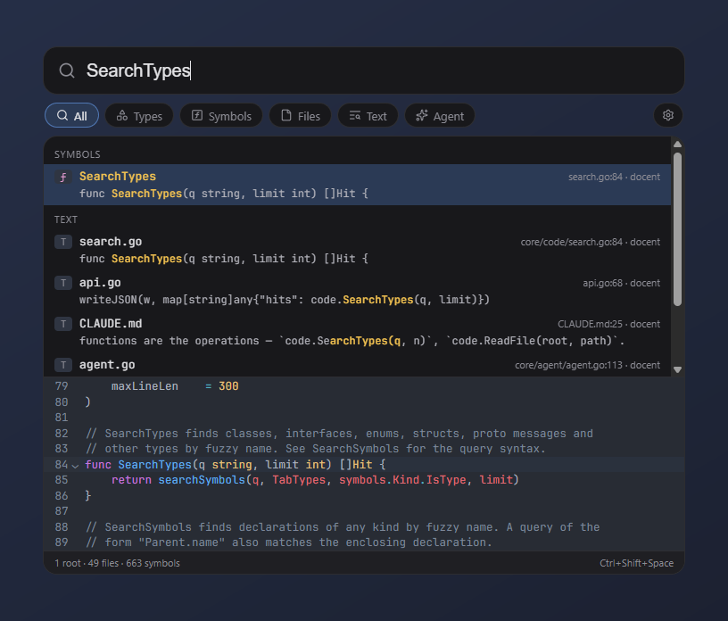
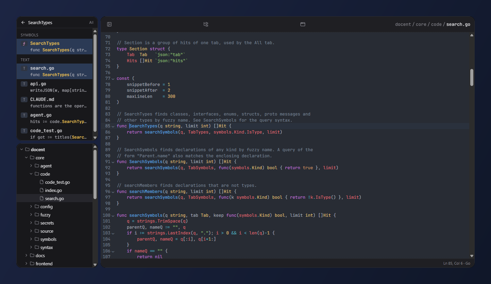
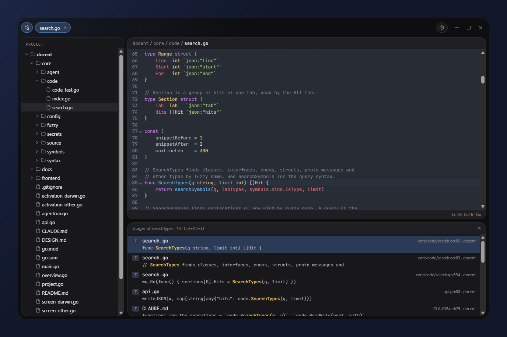
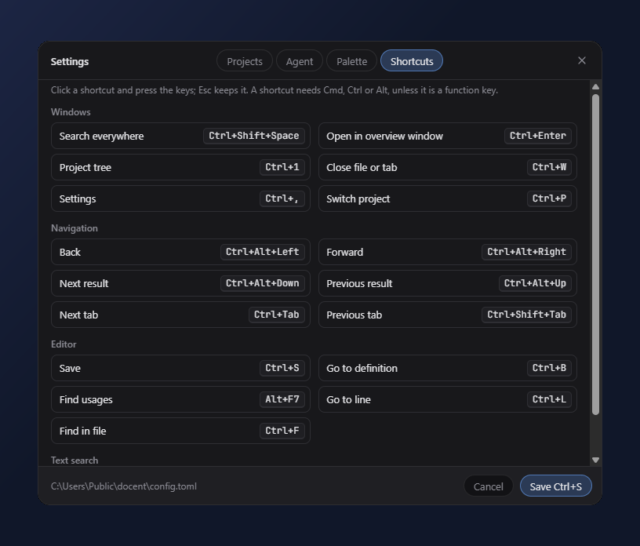

# docent

**Read the code your agents write.**

Writing code is moving to agents. What stays with you is reading it: finding
where something lives, seeing how the pieces fit, checking what changed and
why. A full IDE is too heavy to keep open just for that, and a repository's
web UI is too slow.

Docent is the reading half of an IDE, and nothing else. Point it at any
folder — a whole repository, or just the few services you care about in a
monorepo — and it builds a local index: a trigram index for text and regular
expressions, and tree-sitter declarations for types, functions, fields and
proto messages. No project files, no build, no language servers; it works
the same on code it has never seen before.

Two ways in:

- **Search from anywhere.** A global hotkey brings up a palette over whatever
  you are doing. Find a type, a symbol, a file or a line of text — or ask in
  plain words, and an agent searches the same index for you. Results are
  code snippets, not just file names.
- **Survey a project.** The overview window has the project tree, files in
  tabs, go to definition and find usages: everything for walking through
  code, without the rest of an IDE.

Folders are grouped into projects — work services in one, side projects in
another — and `Cmd+P` switches between them. Only the active project is
indexed and kept in memory, so Docent stays light in the background.



Opening a result shows the file next to the search and the project tree:



The overview window keeps files in tabs, with definitions and usages in a
panel below the code:



Every shortcut can be changed in settings:



The specification is [`DESIGN.md`](DESIGN.md).

## Languages

File and full-text search cover every file. Structural search — the Types
and Symbols tabs, go to definition and find usages — covers the languages
below; the columns are what the index extracts from each.

| Language       | Files                                              | Types | Functions | Fields, constants |
|----------------|----------------------------------------------------|:-----:|:---------:|:-----------------:|
| Bash           | `.sh` `.bash`                                      |       |     ✓     |         ✓         |
| C, C++         | `.c` `.h` `.cc` `.cpp` `.cxx` `.hh` `.hpp` `.hxx` `.ipp` `.inl` |   ✓   |     ✓     |         ✓         |
| C#             | `.cs`                                              |   ✓   |     ✓     |         ✓         |
| CSS            | `.css`                                             |       |           |         ✓         |
| Elixir         | `.ex` `.exs`                                       |   ✓   |     ✓     |                   |
| Elm            | `.elm`                                             |   ✓   |     ✓     |         ✓         |
| Go             | `.go`                                              |   ✓   |     ✓     |         ✓         |
| Groovy, Gradle | `.groovy` `.gradle`                                |   ✓   |     ✓     |         ✓         |
| HCL, Terraform | `.hcl` `.tf` `.tfvars`                             |   ✓   |           |         ✓         |
| Java           | `.java`                                            |   ✓   |     ✓     |         ✓         |
| JavaScript     | `.js` `.jsx` `.mjs` `.cjs`                         |   ✓   |     ✓     |         ✓         |
| Kotlin         | `.kt` `.kts`                                       |   ✓   |     ✓     |         ✓         |
| Lua            | `.lua`                                             |       |     ✓     |                   |
| OCaml          | `.ml`                                              |   ✓   |     ✓     |         ✓         |
| PHP            | `.php`                                             |   ✓   |     ✓     |         ✓         |
| Protobuf       | `.proto`                                           |   ✓   |     ✓     |         ✓         |
| Python         | `.py` `.pyi`                                       |   ✓   |     ✓     |         ✓         |
| Ruby           | `.rb` `.rake` `.gemspec`                           |   ✓   |     ✓     |         ✓         |
| Rust           | `.rs`                                              |   ✓   |     ✓     |         ✓         |
| Scala          | `.scala` `.sc`                                     |   ✓   |     ✓     |         ✓         |
| SQL            | `.sql`                                             |   ✓   |     ✓     |         ✓         |
| Svelte, Vue    | `.svelte` `.vue`                                   |   ✓   |     ✓     |         ✓         |
| Swift          | `.swift`                                           |   ✓   |     ✓     |         ✓         |
| TypeScript     | `.ts` `.tsx` `.mts` `.cts`                         |   ✓   |     ✓     |         ✓         |

Types are classes, structs, interfaces, enums, type aliases, proto messages
and services, SQL tables and namespaces; functions include methods and RPCs;
fields include properties, enum values and variables. Svelte and Vue
components are indexed through their `<script>` blocks, as TypeScript.

## Keys

Defaults; each can be changed in Settings → Shortcuts. `Cmd` is `Ctrl` on
Windows and Linux. Keys are bound by position, so they work in any layout.

| Key                            | Does                                  |
|--------------------------------|---------------------------------------|
| `Cmd+Shift+Space`              | Search everywhere, from any app       |
| `#` `@` `/` `?`                | Types, Symbols, Files, Agent tab      |
| `Tab`                          | Next search tab                       |
| `Enter`                        | Open the result                       |
| `Cmd+Enter`                    | Open it in the overview window        |
| `Cmd+P`                        | Switch project                        |
| `Cmd+1`                        | Project tree                          |
| `Cmd+B`, `Cmd+click`           | Go to definition                      |
| `Alt+F7`                       | Find usages                           |
| `Cmd+Alt+Left` `Cmd+Alt+Right` | Back, forward                         |
| `Cmd+Alt+Down` `Cmd+Alt+Up`    | Next, previous result                 |
| `Ctrl+Tab`                     | Next tab in the overview window       |
| `Cmd+L`, `Cmd+F`               | Go to line, find in file              |
| `Cmd+S`, `Cmd+W`               | Save, close                           |
| `Cmd+,`                        | Settings                              |

## Installing

Download the latest build from
[Releases](https://github.com/syncended/docent/releases): the installer or
the zip for Windows, the DMG for macOS (Apple silicon and Intel).

Builds are not code-signed yet, so the first launch needs one extra step:

- **Windows:** SmartScreen shows "Windows protected your PC" — choose
  "More info", then "Run anyway".
- **macOS:** Gatekeeper refuses to open the app — right-click it and choose
  "Open", or run `xattr -dr com.apple.quarantine /Applications/docent.app`.

Then press the hotkey, add a folder, and search. Settings (`Cmd+,`)
configure projects, their folders, shortcuts and the agent provider; API
keys are kept in the system credential store.

## Building

Requirements: Go 1.26+, Node.js 22+, and the [Wails v3](https://v3.wails.io) CLI:

```sh
go install github.com/wailsapp/wails/v3/cmd/wails3@latest
```

macOS:

```sh
wails3 build
./bin/docent
```

Windows, with a C compiler for tree-sitter
([llvm-mingw](https://github.com/mstorsjo/llvm-mingw) or MSYS2 MinGW-w64 on `PATH`):

```sh
wails3 build
bin\docent.exe
```

To cross-compile for Windows from macOS or Linux, build the Docker image once
with `wails3 task setup:docker`, then run `wails3 build GOOS=windows`.

Tests: `go test ./...`. Docent logs to `docent.log` in its cache directory,
next to the index.

## Releasing

Push a version tag; CI builds Windows and macOS packages and publishes a
GitHub Release (a tag with a suffix, like `v0.2.0-rc.1`, is a pre-release):

```sh
git tag v0.1.0
git push origin v0.1.0
```

`build/set-version.sh` writes the tag's version into the build assets.

## License

[MIT](LICENSE).
